<div align="center">


# NEXUS AI

**An autonomous research, intelligence and execution workspace that shows its work.**

Think → Plan → Research → Analyze → Verify → Create — on a local model, with real web sources, grounded document
citations, computed data analysis, multi-agent missions you can watch, and human approval checkpoints.

`Next.js 16` · `React 19` · `FastAPI` · `LangGraph` · `PostgreSQL + pgvector` · `Redis` · `DuckDB` · `Ollama` · `MCP`

</div>

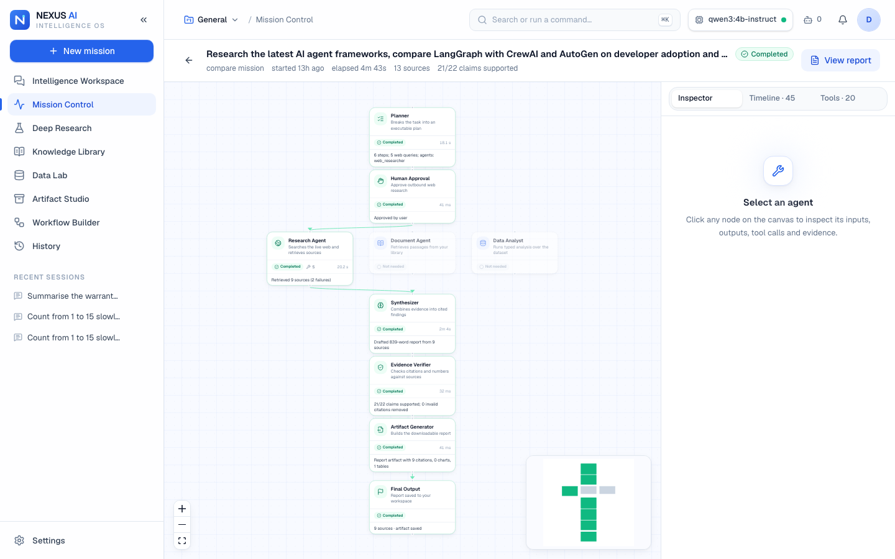

## Why

Most AI apps return a single opaque answer. NEXUS treats an answer as the output of an inspectable process: the
plan, which agents ran, every tool call, every source that was (or could not be) retrieved, the exact passage
behind each citation, the SQL behind each number, and a verification report — all persisted, replayable after a
reload, and exportable.

## Key capabilities

| | |
|---|---|
| **Intelligence Workspace** | Streaming chat (resumable SSE) in four modes — Chat, Research (live web), Analysis (dataset), Agent (mission). Markdown, code, tables, math, inline charts, clickable citations, follow-up suggestions, stop/retry/regenerate, drag-and-drop attachments. |
| **Mission Control** | Live React Flow graph of a LangGraph mission: Planner → Human Approval → Research / Document / Data agents → Synthesizer → Evidence Verifier → Artifact Generator → Final Output. Node states come only from persisted events. Inspector with plan, live draft, sources, verification and tool calls; timeline; pause, resume, cancel, retry-from-checkpoint and approvals. |
| **Deep Research Studio** | Four genuinely different workflows (Quick, Deep, Compare, Document + Web), source library with retrieval status, direct URL research, live search. |
| **Knowledge Library** | PDF/TXT/MD/DOCX/CSV/XLSX ingestion, page-aware chunking, local embeddings, hybrid pgvector + full-text retrieval (RRF), PDF viewer that opens at the cited page, retrieval inspector with ranks and scores. |
| **Data Lab** | DuckDB sandbox over Parquet, column profiling, chart builder, guarded read-only SQL console with CSV export, and an AI analyst that only *selects* typed operations — every number is computed. |
| **Artifact Studio** | Versioned reports and analyses with citations, tables and verified charts; edit in Monaco to create new versions; export Markdown, JSON, CSV and PDF. |
| **Workflow Builder** | Typed node editor (Input, Web Search, Document Retrieval, LLM Reasoning, Data Analysis, Verification, Human Approval, Artifact Generation, Output) with validation, cycle rejection, four runnable templates, and runs on the same LangGraph runtime. |
| **MCP server** | Authenticated Streamable-HTTP MCP endpoint exposing read-only workspace tools to external clients, with a connector page showing availability, calls and errors. |

## Screenshots

All screenshots are captured by Playwright from the running application (`make screenshots`).

| | |
|---|---|
| 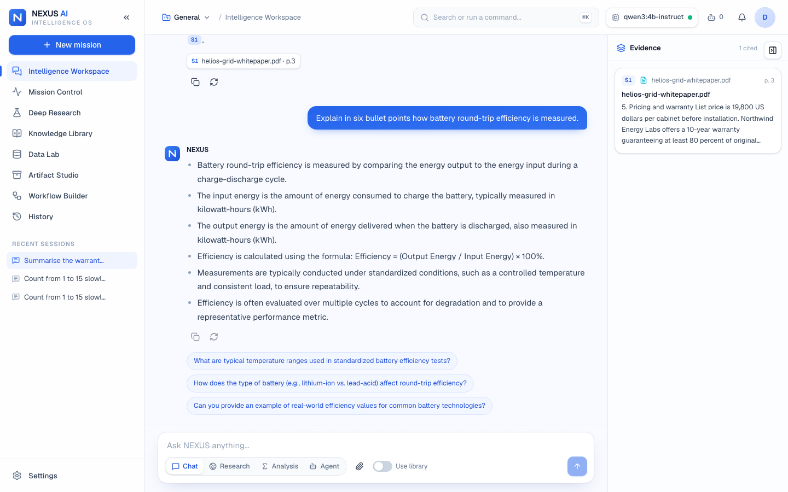 Grounded chat with page-level citations | 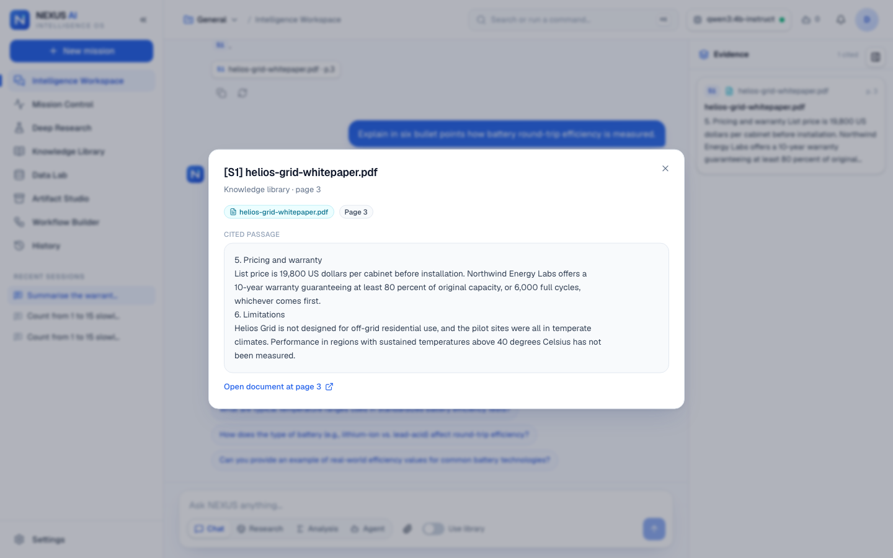 The stored passage behind a citation |
| 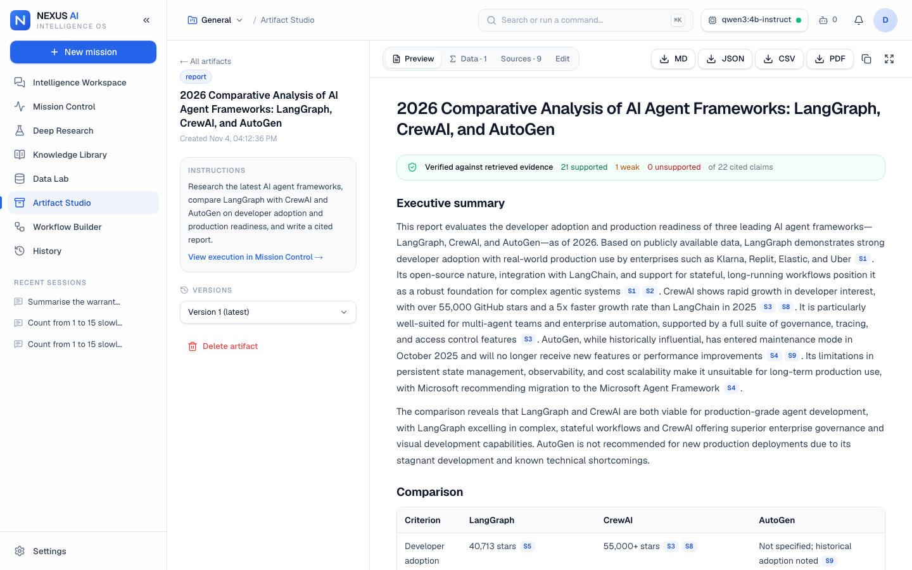 Verified comparison report | 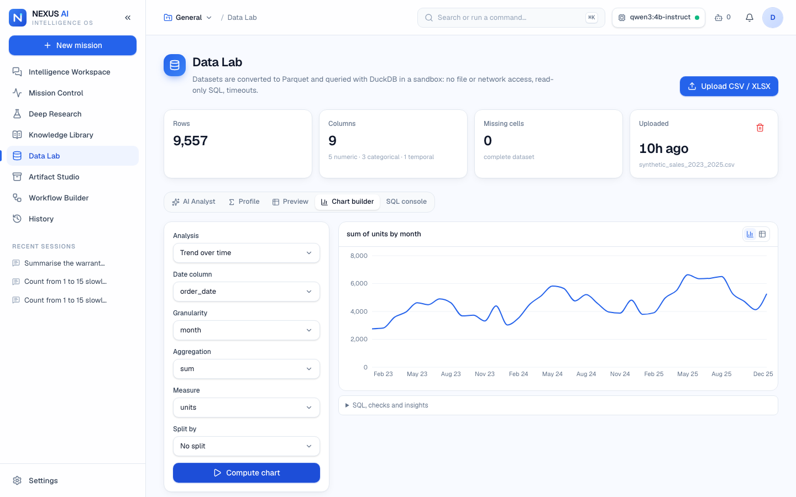 Computed chart in the Data Lab |
| 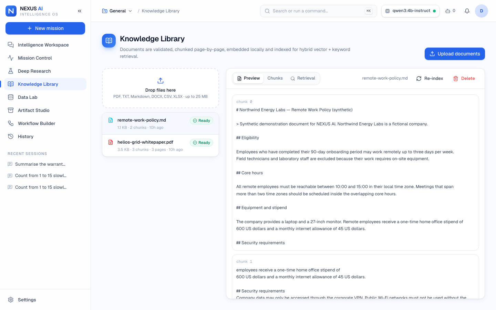 Knowledge Library with PDF viewer | 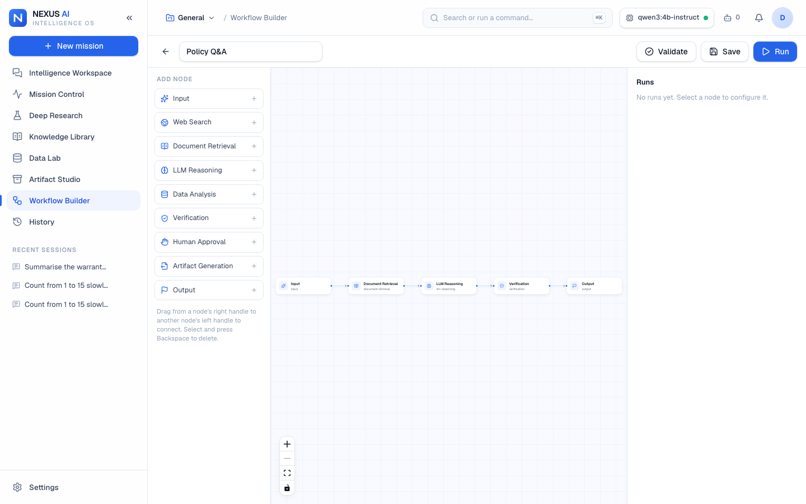 Workflow Builder |
| 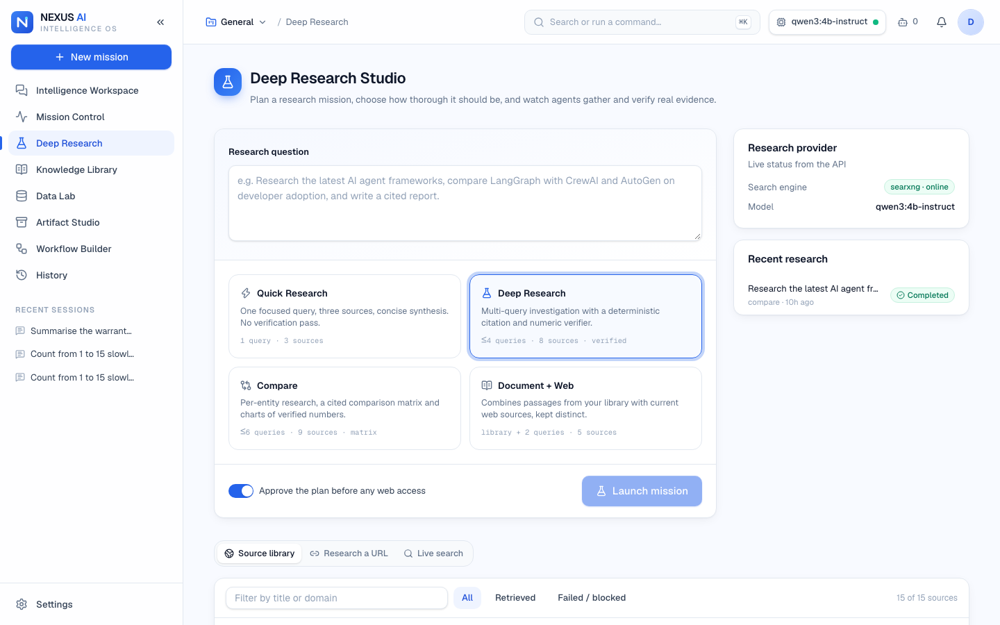 Deep Research Studio | 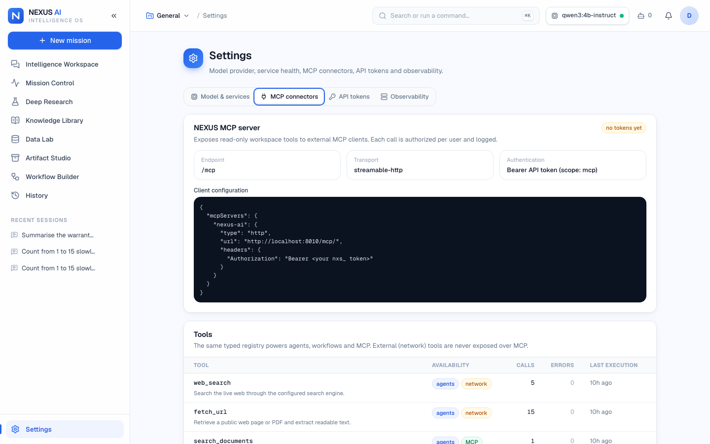 MCP connectors |
| 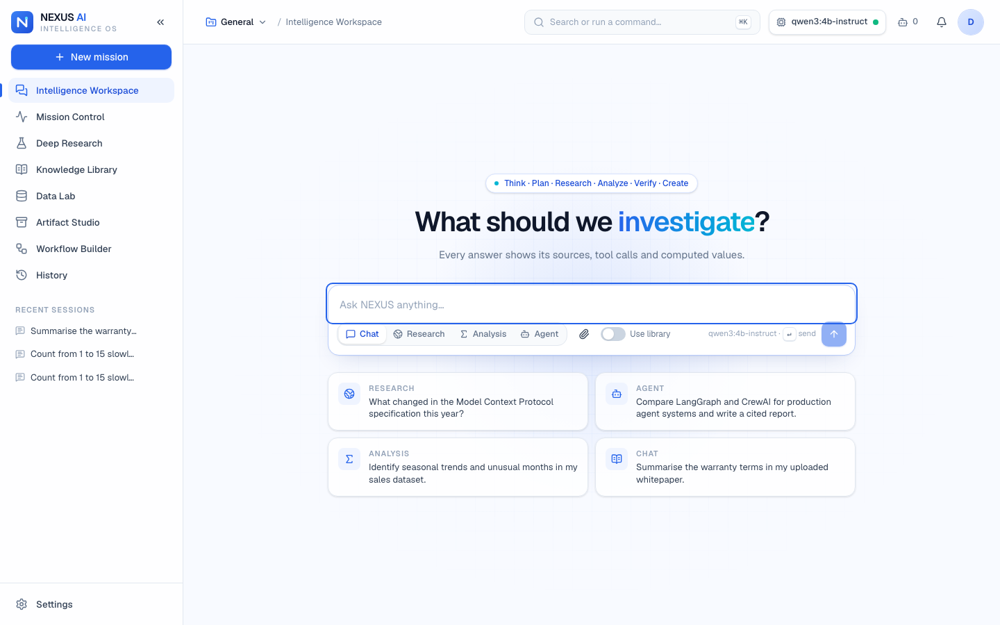 Workspace home | 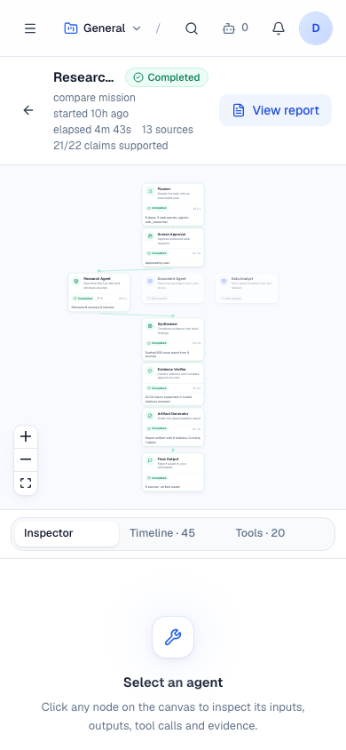 Mobile |

## Architecture

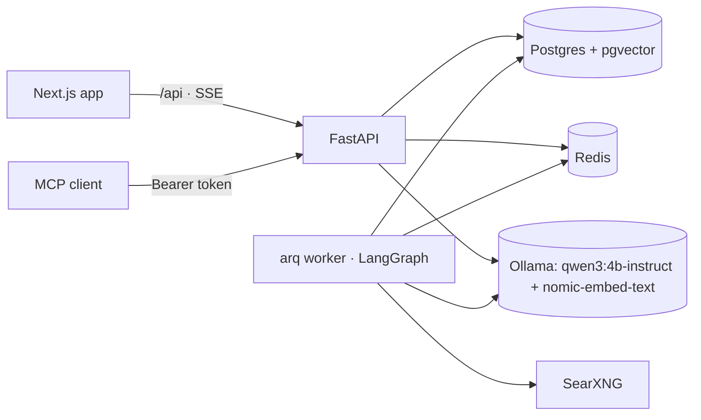

* **Backend**: routers → services → domain → models; a single typed tool registry is shared by agents, workflows and
  MCP, with per-user scoping, budgets, timeouts and a `tool_calls` audit log. Details: [ARCHITECTURE](docs/ARCHITECTURE.md).
* **Agents**: LangGraph with a Postgres checkpointer; durable interrupts for approvals; pause, retry from checkpoint,
  immediate cancellation; step and tool-call budgets. Details: [AGENTS](docs/AGENTS.md).
* **RAG**: hybrid retrieval, citation mapping to chunks and pages. Details: [RAG](docs/RAG.md).
* **Web research**: SearXNG + an SSRF-hardened fetcher with IP pinning. Details: [WEB_RESEARCH](docs/WEB_RESEARCH.md).
* **Data**: sandboxed DuckDB, sqlglot SQL guard, typed operations. Details: [DATA_ANALYSIS](docs/DATA_ANALYSIS.md).
* **MCP**: [MCP](docs/MCP.md) · **Security**: [SECURITY](docs/SECURITY.md) · **API**: [API](docs/API.md) ·
  **Decisions**: [DECISIONS](docs/DECISIONS.md) · **Deployment**: [DEPLOYMENT](docs/DEPLOYMENT.md) · **Demo**: [DEMO](docs/DEMO.md)

### Frontend architecture

`src/app` (routes) · `src/features/*` (chat, missions, research, library, data, artifacts, workflows, settings) ·
`src/components/{ui,shell,editor}` (design system on Radix primitives) · `src/lib` (typed API client, resumable SSE
client, TanStack Query hooks) · `src/stores` (persisted UI state). White-and-electric-blue token system in
`globals.css`, Geist typography, a validated colour-blind-safe chart palette, reduced-motion support, keyboard
command palette (⌘K) and shortcuts (⌘\, ⌥⌘1–9).

## Quick start

Requirements: macOS/Linux, Docker, Node 24, [uv](https://docs.astral.sh/uv/), [Ollama](https://ollama.com).

```bash
make setup     # dependencies, .env with random secrets, Ollama models (~2.8 GB)
make up        # Postgres + pgvector, Redis, SearXNG, migrations
make dev       # API on :8010, worker, web on :3000
make seed      # in a second terminal: demo account + synthetic sample content
```

Open http://localhost:3000 and sign in with `NEXUS_DEMO_EMAIL` / `NEXUS_DEMO_PASSWORD` from `.env`
(or create your own account). `make demo` does all of this in the background.

### Local LLM setup

```bash
brew install ollama && brew services start ollama
make models    # pulls qwen3:4b-instruct and nomic-embed-text
```

To use a different model set `NEXUS_CHAT_MODEL`. An OpenAI-compatible endpoint (vLLM, LM Studio, a hosted API) is
supported but strictly opt-in: `NEXUS_LLM_PROVIDER=openai_compat` with `NEXUS_OPENAI_BASE_URL`,
`NEXUS_OPENAI_MODEL`, `NEXUS_OPENAI_API_KEY`. Embeddings always stay local, and Settings warns when prompts leave
the machine. If the model is unreachable the UI shows the real error — there are no canned responses.

### Environment variables

See [.env.example](.env.example). The important ones: `NEXUS_SECRET_KEY`, `NEXUS_DATABASE_URL`, `NEXUS_REDIS_URL`,
`NEXUS_LLM_PROVIDER`, `NEXUS_CHAT_MODEL`, `NEXUS_EMBED_MODEL`, `NEXUS_NUM_CTX`, `NEXUS_SEARCH_PROVIDER`,
`NEXUS_SEARXNG_URL`, `NEXUS_MISSION_MAX_STEPS`, `NEXUS_MISSION_MAX_TOOL_CALLS`.

## Demo walkthrough

[docs/DEMO.md](docs/DEMO.md) walks through the four scenarios: a streamed answer, a document question with an
inspectable page citation, a dataset analysis with interactive charts, and a research mission with live sources,
Mission Control and an exported artifact.

## Testing

| Suite | Command | What runs | Real model? |
|---|---|---|---|
| Backend | `make test-backend` | 102 tests: auth, cross-user isolation, ingestion and hybrid retrieval, chat streaming and resume, SSRF, SQL guard, typed analytics vs pandas, missions (approval, pause/resume, retry-from-checkpoint, cancel, budgets), workflows, MCP over HTTP, exports | No — deterministic fixture provider against real Postgres + pgvector |
| Live smoke | `make test-live` | Ollama streaming, embeddings, structured output; live SearXNG search and page fetch | **Yes** |
| Frontend | `make test-frontend` | 20 Vitest tests: resumable SSE, background polling of in-flight work, mission graph derivation, composer behaviour, citation rendering, charts, auth forms | No |
| E2E | `make e2e` | Playwright journey: register, project, streamed reply, upload + citation, dataset chart, mission, artifact download, reload persistence | **Yes** (local stack) |
| Evaluations | `make eval` (`--live` for model checks) | See below | Partly |

The fixture provider is selectable only with `NEXUS_ENV=test` and identifies itself as `fixture` in every
response, so a test can never be mistaken for real model behaviour.

## Evaluation methodology

`backend/evals/run.py` over `backend/evals/dataset.json`; latest results in
[evals/results/latest.md](backend/evals/results/latest.md). Measured on the development machine:

| Check | Type | Result |
|---|---|---|
| Citation grounding verdicts | deterministic | 6/6 correct |
| Prompt-injection pattern detection | deterministic | 6/6 hostile flagged, 0/5 benign false positives |
| SQL guard | deterministic | 8/8 unsafe blocked, 3/3 safe allowed |
| Document retrieval (10 questions) | deterministic given local embeddings | recall@1 0.7, recall@5 1.0, MRR 0.85, page accuracy 5/5 |
| Numeric correctness vs pandas | deterministic (via API) | 4/4 |
| Analyst tool selection (4 questions) | live model | 4/4 |
| Canary leak under injected instructions | live model | 0/5 leaks |

These are small, purpose-built sets: they catch regressions and demonstrate the guarantees; they are not
benchmarks of general model quality.

## CI/CD

`.github/workflows/ci.yml`: Ruff, mypy and the backend suite against a pgvector service; deterministic evals; ESLint,
`tsc`, Vitest and a production Next.js build; Docker builds for both images and a compose config check; a Gitleaks
full-history secret scan; Mermaid diagram validation. No model API keys are needed — CI uses the fixture provider.
Live-model, live-search and E2E suites run locally against a real stack.

## Known limitations

* A 4B local model writes competent but not expert reports; compare-mode synthesis takes 1–3 minutes on an M4.
  Point `NEXUS_CHAT_MODEL` at a larger model for better reasoning.
* Verification is lexical and numeric, not semantic entailment.
* Search quality depends on which SearXNG upstream engines respond (some rate-limit or CAPTCHA automated queries;
  those are reported, never bypassed).
* Scanned PDFs are not OCR'd; they are rejected with a clear message.
* Single machine by design: one worker process, Ollama serialises requests, no multi-tenant deployment hardening
  beyond per-user isolation.
* The light theme is the designed theme; there is no dark mode yet.

## Future improvements

Consuming external MCP servers as agent tools behind approvals · OCR for scanned PDFs · semantic (NLI) claim
verification · reranking model for retrieval · dark theme · multi-worker scaling and OpenTelemetry export ·
collaborative projects.

## License

MIT. Sample documents and datasets are synthetic and were written for this project.
