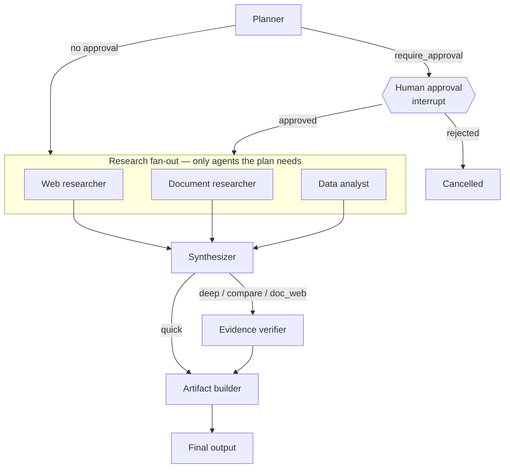

# Agents and orchestration

Missions are LangGraph `StateGraph`s compiled with a Postgres checkpointer (`langgraph-checkpoint-postgres`),
executed by the arq worker. Thread id = task id.

| Agent | What it really does |
|---|---|
| Planner | Structured output (`MissionPlan` JSON schema, constrained decoding in Ollama). Mode rules are enforced in code: query caps, compare requires ≥2 entities (with a deterministic regex fallback), documents only if the library has them, data only if a dataset is attached. |
| Human approval | `interrupt()` with the planned queries. Durable: the worker can restart while it waits. The user can edit queries; rejection cancels with no external calls made. |
| Web researcher | `web_search` per query → round-robin selection with ≤2 results per domain → parallel `fetch_url` (semaphore 4) → relevant-paragraph selection. Failed/blocked sources are reported, not hidden. |
| Document researcher | `search_documents` (hybrid RRF) over the selected documents or whole library. |
| Data analyst | Selects operations from a profile-derived catalog; DuckDB computes; results are labelled `D#`. |
| Synthesizer | Streams a cited Markdown report; draft deltas are published live (not persisted) for Mission Control. Compare mode also extracts a cited comparison matrix. |
| Verifier | Deterministic: removes citation labels that do not exist, scores lexical support per cited sentence, checks every number against cited text. Charts are only drawn from verified numbers. |
| Artifact builder | Stores a versioned report with citations, tables, charts and the verification report. |

## Controls and limits

* **Cancel**: a Redis flag; the worker's watcher cancels the coroutine immediately, even mid-LLM call.
* **Pause**: checked at every node boundary → `PauseRequested`; resume continues from the last checkpoint
  (`ainvoke(None)`), so completed nodes never re-run.
* **Retry**: a failed task resumes from its last successful checkpoint (tested: research is not repeated when
  synthesis failed).
* **Budgets**: `recursion_limit` = `NEXUS_MISSION_MAX_STEPS`; tool calls per task are counted in Redis and denied
  past `NEXUS_MISSION_MAX_TOOL_CALLS`; each tool has its own timeout.
* **Honest failure**: exceptions are recorded on the node (`node_failed`), the task (`task_failed`, `error`) and the
  agent run; the UI shows the reason and offers retry.

## Workflow engine

User-built DAGs (`nexus/workflows`) are validated (types, connectivity, single input, outputs, acyclicity,
dataset ownership) and compiled into a LangGraph graph whose join nodes use list edges, so a node waits for all
predecessors. They reuse the same instrumentation, events, approvals and checkpoints as missions.
