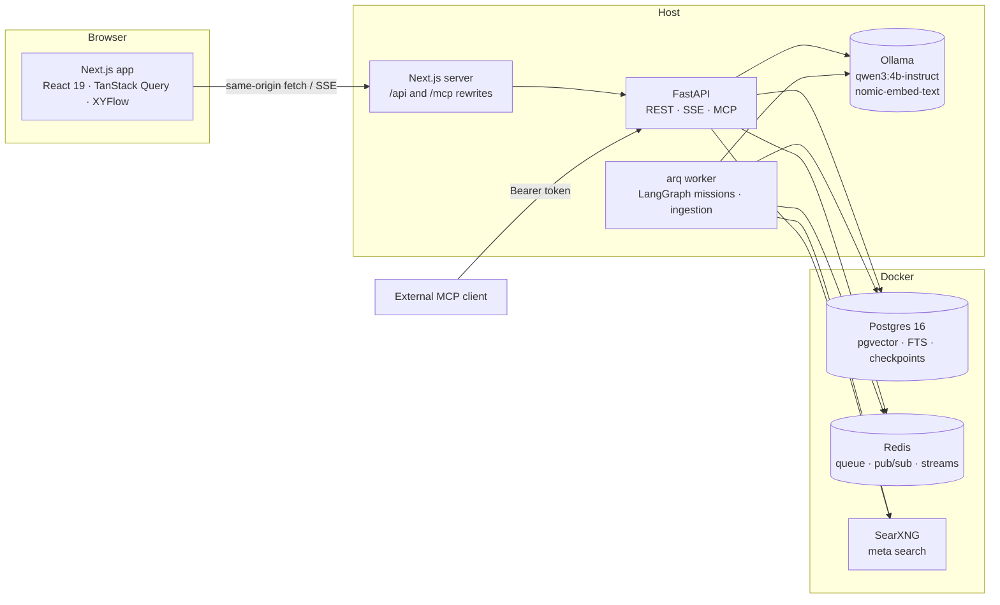
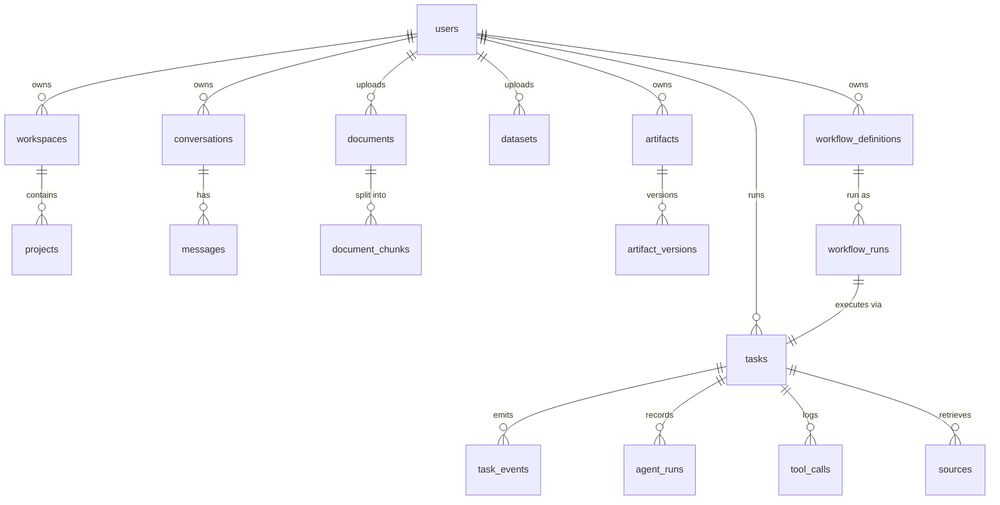

# Architecture

NEXUS AI is a local-first monorepo: a Next.js frontend, a FastAPI API, an arq background worker, and three
infrastructure containers (Postgres + pgvector, Redis, SearXNG). Inference runs on the host through Ollama so it
can use the Mac's GPU (Docker on macOS has no Metal access).

## Backend layering

| Layer | Location | Responsibility |
|---|---|---|
| Routers | `nexus/api/routers/*` | HTTP shape, validation, authorization (every query is filtered by `user_id`) |
| Services | `nexus/services`, `nexus/rag/ingest.py`, `nexus/research/service.py`, `nexus/artifacts/service.py` | Use cases that combine storage and integrations |
| Domain | `nexus/domain/*` | Pure logic: chunking, SQL guard, untrusted-content handling |
| Agents / workflows | `nexus/agents`, `nexus/workflows` | LangGraph graphs, prompts, verifier, analyst |
| Tools | `nexus/tools/registry.py` | Typed, user-scoped, budgeted, logged capabilities shared by agents, workflows and MCP |
| Integrations | `nexus/llm`, `nexus/research/search.py`, `nexus/data/engine.py` | Ollama/OpenAI-compatible providers, SearXNG, DuckDB |
| Persistence | `nexus/models.py`, `alembic/` | SQLAlchemy 2 async models and migrations |

## Data model

Indexes worth noting: `document_chunks.embedding` (HNSW, cosine), `document_chunks.tsv` (GIN, generated
`to_tsvector`), `task_events (task_id, id)` for ordered replay, `messages (conversation_id, created_at)`,
`documents (user_id, sha256)` unique for deduplication. All user-owned foreign keys cascade on delete.

## Real-time model

* **Chat**: generation runs in the API process and appends events (`delta`, `tool`, `sources`, `analysis`,
  `done`, `end`) to a Redis stream per message. The SSE endpoint reads that stream from any offset, so a reload or a
  dropped connection resumes exactly where it left off (`Last-Event-ID`). The final message is written to Postgres
  regardless of whether a browser is connected; messages left `streaming` by a crash are marked as interrupted.
* **Missions and workflows**: the worker writes every typed event to `task_events` (source of truth), then
  publishes it on Redis pub/sub. The SSE endpoint subscribes first, replays from Postgres after `Last-Event-ID`,
  then follows live — no gap, no duplicates. Mission Control derives every node state from these events only.

## Frontend structure

`src/app` holds routes only; features live in `src/features/<area>` (chat, missions, research, library, data,
artifacts, workflows, settings); shared primitives in `src/components/ui`; shell in `src/components/shell`;
typed API client, SSE client and query hooks in `src/lib`; persisted UI state (sidebar, panel layout, active
project) in a Zustand store. Server state is TanStack Query; no business logic is duplicated client-side.
