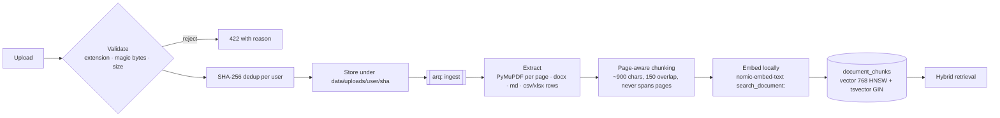

# Knowledge library and RAG

**Retrieval.** The query is embedded with the `search_query:` prefix. Two candidate lists (30 each) come from
pgvector cosine distance and from Postgres full-text search (`to_tsquery` with OR semantics), both scoped to the
user and to ready documents. They are fused with reciprocal rank fusion (k = 60). Each hit carries its vector rank,
cosine similarity, keyword rank and fused score, all visible in the Library's Retrieval tab.

**Citations.** Evidence is injected as `[S#]` blocks inside an `<evidence>` wrapper. After generation, labels that
do not correspond to retrieved evidence are stripped and reported. Each citation stores `chunk_id`, `document_id`,
`filename` and `page`; the citation dialog fetches the stored passage from the API and links to the PDF viewer at
that page (with term highlighting in the text layer). Page numbers come from the PDF page the chunk was cut from —
never from the model.

**Deletion** removes the document row (chunks and citations cascade) and the stored file when no other row
references it.

**Measured** (see `evals/results/latest.md`, 10 questions over the sample documents, local embeddings):
recall@1 0.7, recall@5 1.0, MRR 0.85, page accuracy 5/5.
