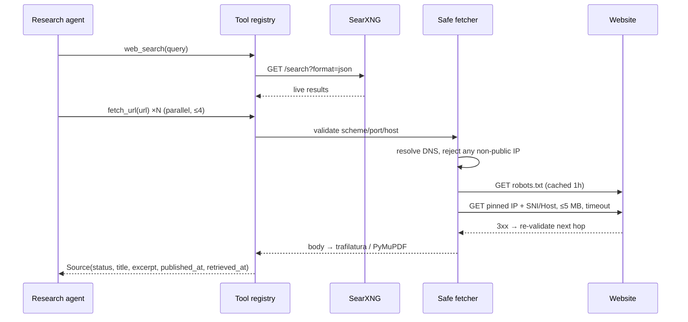

# Web research

**Provider.** SearXNG runs in Docker with JSON output enabled; results are passed through unchanged (title, URL,
snippet, engine). If search is unavailable the tool raises and the mission reports it; direct URL research
(Deep Research → Research a URL) still works. Set `NEXUS_SEARCH_PROVIDER=none` to disable search entirely.

**SSRF defences** (`nexus/research/safe_fetch.py`, tested in `tests/test_security.py`): http/https only; ports
80/443/8080/8443; no credentials in URLs; `localhost`, `.local`, `.internal` rejected; every resolved address
must be globally routable (loopback, RFC 1918, link-local incl. 169.254.169.254, CGNAT, multicast, IPv4-mapped IPv6
are rejected, and a mixed public/private answer is rejected outright); the connection is pinned to the validated
IP so DNS rebinding between check and connect is impossible; redirects are followed manually and each hop is
re-validated; bodies are capped; robots.txt is honoured.

**Provenance.** Every retrieved, failed or blocked page becomes a `sources` row with HTTP status, final URL,
retrieval timestamp and, when the page states one, a publication date. Only `retrieved` sources can be cited.

**Prompt injection.** Page text is neutralised (forged `</evidence>`/`<system>` tags are broken), scanned for
instruction-like phrases (flagged on the source and shown to the user), and wrapped in an evidence block that the
system prompt declares to be data. A live canary test checks the model does not leak a planted secret.
